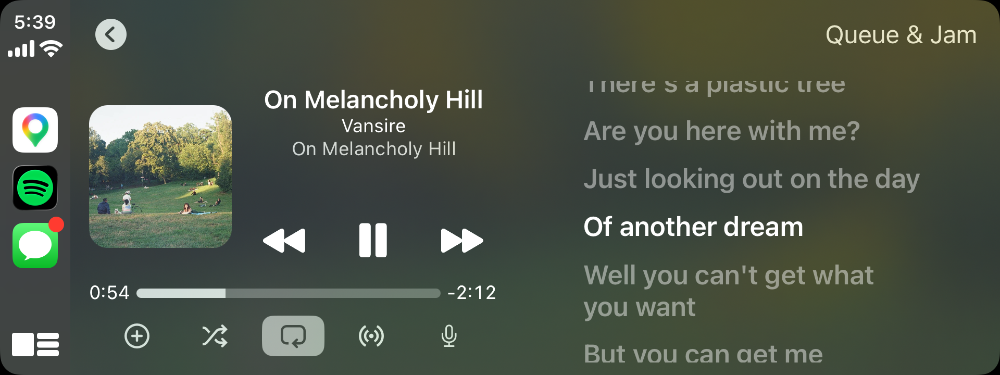

<div align="center">

# carLy

### *lyrics where you already look*



</div>

---

carLy is a tweak for jailbroken iPhones that puts time-synced lyrics on CarPlay's own Now Playing screen. It changes the player the car already shows rather than adding an app you have to switch to, so the lyrics sit next to the controls you already use, for Spotify, Apple Music and most other audio apps. It is built for iOS 17 on rootless jailbreaks (Dopamine), and has been tested in a car with an iPhone 15 Pro on iOS 17.3.

The CarPlay screen for a template app like Spotify is drawn by a system process, `CarPlayTemplateUIHost`, not by the app. carLy loads there and hands the host a smaller area for its player, so CarPlay lays out its own controls in a column and the lyrics fill the rest. Side by Side keeps the cover, No Artwork drops it for more lines, and either can sit on the left or the right. Wherever the screen is too small to split, a microphone in the player's button row opens the lyrics across the whole display with the song and previous / play-pause / next under them. Every layout is worked out from CarPlay's own measurements, read from the iOS 17.3 shared cache, and designed first for the 640 x 240 widescreen head units that leave the least room.

Lyrics come from the service that plays the song wherever it has them. **Spotify** songs get the lyrics Spotify itself shows: carLy also loads into the Spotify app, which fetches them with the session it already has and hands them to the CarPlay screen through a shared folder. The session never leaves the Spotify app. **Apple Music** songs get Apple's synced lyrics, fetched by the Music app, whose CarPlay screen carLy handles in-process. Library songs can use lyrics saved in the file (LRC inside USLT, SYLT, FLAC/Vorbis `LYRICS`) or a sidecar `.lrc`. Everything else comes from [LRCLIB](https://lrclib.net), a free community database, or an address of your own. Sources are tried in the order you choose; synced lines beat plain text.

Settings has a live preview of every layout on three screen shapes, plus fonts, weights, colours, alignment, a background behind the lines, which apps show lyrics, the source order, and two timing offsets: one for Spotify's and Apple's lyrics, which match their own audio, and one for everything else.

## Installing

carLy is published in my package repository. Add the source in Sileo or Zebra and then search for carLy.

**Repository**

https://reallyitsandi.com/repo/

After installing, close Spotify and open it again once so carLy can load into it.

## Privacy

No accounts, keys, analytics or telemetry. carLy only connects to the lyrics sources you leave on: Spotify's lyrics service (through the Spotify app), Apple's (through the Music app), LRCLIB, and your custom address if you set one. Only the song's title, artist, length and, for Spotify, its track id are sent.

## Building

carLy builds on a Mac with Xcode and [Theos](https://theos.dev). The arm64e slice has to come from Xcode's clang: Procursus' on-device clang does not sign Objective-C class metadata the way iOS 17's arm64e runtime expects, and its build crashes `CarPlayTemplateUIHost` at load.

```sh
export THEOS=~/theos
./scripts/build-mac.sh     # build the .deb into packages/ (arm64 + arm64e)
scripts/test-mac.sh        # 1,700+ logic tests and the layout harness, in an iOS 17 simulator
```

The logic (LRC and TTML parsers, the sync engine, the protobuf reader, the providers, the Spotify hand-off) is plain Foundation and runs without a car. The layout code is exercised against fake CarPlay classes that carry the real private ivar names. Everything else needs a head unit; Apple's CarPlay Simulator (Additional Tools for Xcode) with the phone plugged into the Mac behaves exactly like one.

## Releasing

Publishing goes through the shared ios-port-ci pipeline (see `.github/workflows/publish.yml`): a push to `main` that touches the tweak rebuilds it from source on a macOS runner and republishes the APT repository at the version in `control` (with `packaging/revision` applied when it names that version), and a tag like `v1.0.1` ships exactly that version. Every published version stays downloadable, so rolling back is a normal package-manager operation.

The repository is signed with its own key, published beside the index as `carly.gpg`; reallyitsandi.com pins that fingerprint before syncing it into the source users actually add.

## License

MIT. See `LICENSE`.

carLy is not affiliated with Spotify, Apple or LRCLIB.
